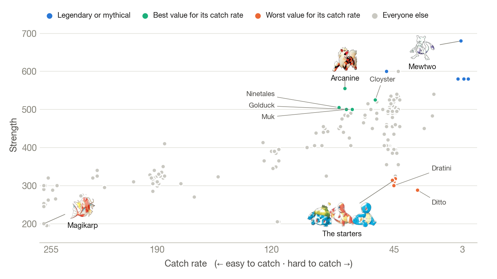

# Kanto by the Numbers

A statistical look at Gen 1 Pokémon.

Anyone who grew up with the Game Boy games or the anime picked up a few rules about Pokémon: rare ones are strong, bigger means stronger, colour gives away the type, and evolving is always worth it. This project tests those rules on the 151 Pokémon of the Kanto region using correlation, permutation tests and a random forest model.

**Interactive page:** https://shyam46699.github.io/kanto-by-the-numbers/

**Code and data:** https://github.com/Shyam46699/kanto-by-the-numbers



*Catch rate and strength for all 151 Gen 1 Pokémon (Q1).*

## The six questions

| | Question | Short answer |
|---|---|---|
| Q1 | Are rarer Pokémon stronger? | Yes, strongly (ρ = 0.73). The starters are the main exception. |
| Q2 | Does size equal power? | Yes, within every evolution stage, not just because evolved Pokémon are bigger. |
| Q3 | Can a Pokémon be both fast and tough? | There is a speed–toughness trade-off within each evolution group, hidden when they are pooled (Simpson's paradox). |
| Q4 | Does colour give away the type? | Partly. Green Pokémon are seven times more likely than average to be Grass types. |
| Q5 | How much stronger does evolving make a Pokémon? | All 72 evolutions add strength, about 42% in a typical case. |
| Q6 | Can a machine learning model predict strength without the battle stats? | Yes, to within about 32 points on average, mostly from evolution stage and size. |

Strength is the base stat total, the sum of the six battle stats.

## What is in this repository

```
docs/        the interactive page (served by GitHub Pages)
scripts/     all code: data download, dataset build, statistics, model, figures
data/        the processed dataset and the PokéAPI downloads it was built from
results/     every number quoted in the article, as JSON and CSV
figures/     the chart shown above
```

## Rerunning the analysis

You need Python 3.9 or later.

```bash
python3 -m venv .venv
.venv/bin/pip install -r requirements.txt
```

The processed dataset and all results are already included, so steps 1 and 2 are optional.

1. **Data.** The PokéAPI files are in `data/raw/pokeapi/`; `scripts/fetch_pokeapi.py` downloads them again if needed. The battle stats come from a Kaggle dataset (reference 2 below), which is not included here. Download it and save it as `data/raw/PokemonData.csv`, then build the dataset:
   ```bash
   .venv/bin/python scripts/build_dataset.py
   ```
2. **Statistics and model.** Run these in order. Both write to `results/`.
   ```bash
   .venv/bin/python scripts/analyse_questions.py
   .venv/bin/python scripts/train_model.py
   ```
3. **Interactive page data.** `scripts/prepare_article.py` rebuilds `docs/data.json` and `docs/sprites.webp`. The sprite sheet needs the Kaggle image set (reference 3), saved as `data/raw/gen1-images.zip`.
4. **Static figures.** `scripts/make_linkedin_figures.py` draws the article's charts into `linkedin/images/` (created on your computer, not stored here). It uses the EB Garamond and Libre Franklin fonts (free, SIL Open Font Licence) from the [Google Fonts repository](https://github.com/google/fonts); place the `.ttf` files in `assets/fonts/`.

Every random step uses a fixed seed (42), so the results are reproducible.

## Methods in brief

- Correlations are Spearman rank correlations with 95% bootstrap confidence intervals (10,000 resamples).
- Each result is checked with a permutation test (10,000 shuffles), and p-values are adjusted for multiple testing with the Benjamini–Hochberg method.
- The model is a random forest (500 trees, scikit-learn), evaluated with leave-one-out cross-validation and compared with a mean baseline and a ridge regression. Feature importance is permutation importance over repeated 5-fold cross-validation.

## References

1. PokéAPI, the RESTful Pokémon API. https://pokeapi.co. Height, weight, colour, catch rate, evolution chains and original types.
2. Lomuscio, M. Pokemon (stats for Generations 1–6). Kaggle. https://www.kaggle.com/datasets/mlomuscio/pokemon. Battle stats (values used in later games) and legendary status.
3. RogerKoala. Pokemon (151 first-generation Pokémon). Kaggle. https://www.kaggle.com/datasets/rogerkoala/first-gen-pokemon. Original Red/Blue artwork.
4. Pedregosa, F. et al. (2011). Scikit-learn: Machine Learning in Python. *Journal of Machine Learning Research*, 12, 2825–2830.

## Licence and credits

The code is released under the MIT Licence (see `LICENSE`).

Pokémon and all character artwork are © Nintendo, Creatures Inc. and GAME FREAK; artwork by Ken Sugimori. The artwork in `docs/sprites.webp` and `figures/` is not covered by the MIT Licence. This is an unofficial fan project for learning and fun.

Author: Ghanashyam Danam
